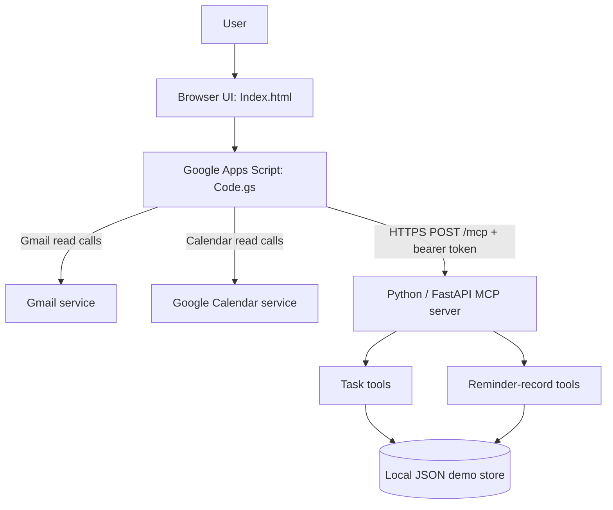

# TaskFlow AI — System Architecture

## Overview

TaskFlow AI is a hackathon MVP with a browser interface, a Google Apps Script layer, and a Python/FastAPI MCP server. Gmail and Google Calendar reads are handled by Apps Script. Task and reminder-record operations are delegated to the MCP server.

## Components

### Browser interface — `Index.html`

Renders the productivity dashboard and mission workspace. It calls Google Apps Script functions through `google.script.run`; browser code does not contain the MCP bearer token.

### Google Apps Script — `Code.gs`

Acts as the application backend and MCP client. It initializes the MCP session flow, verifies the negotiated protocol version, sends `notifications/initialized`, calls `tools/list`, and sends `tools/call` requests with `MCP-Protocol-Version: 2025-11-25`. Gmail and Calendar read operations remain in Apps Script.

### MCP server — `server.py`

A stateless Streamable HTTP server implemented with Python and FastAPI. It receives JSON-RPC requests at `POST /mcp` and exposes these tools:

| Tool | Purpose |
|---|---|
| `create_task` | Create a task record. |
| `list_tasks` | List task records for an owner. |
| `set_task_done` | Mark a task complete or incomplete. |
| `delete_task` | Delete a task record. |
| `create_reminder` | Store a reminder record. |
| `list_reminders` | List reminder records. |

### Storage

The server stores tasks and reminder records in a local JSON file. This is suitable for a controlled prototype but not reliable persistent storage on hosting plans with ephemeral filesystems.

## Request flow: create and verify a task

1. A user enters a supported request in Mission Control.
2. Apps Script interprets the supported request and calls `create_task` through MCP.
3. The MCP server validates the owner and title, stores the task, and returns the result.
4. Apps Script calls `list_tasks` to retrieve the updated list.
5. The UI presents the result and activity sequence.

The second read is important: a user-facing success message alone is not treated as verification.

## Security boundaries

- The MCP server uses `MCP_API_TOKEN` as a bearer token.
- `MCP_SERVER_URL` and `MCP_API_TOKEN` belong in Apps Script Script Properties.
- `MCP_API_TOKEN` belongs in the Render environment.
- The token must never be embedded in `Index.html` or committed to GitHub.
- The Google Apps Script web app should be restricted to trusted users because it can read Google account data with the user's granted permissions.

## Deliberate MVP limitations

- The mission runner uses rules for a small supported request set; it is not a general LLM planner.
- Reminder records are saved/listed, but no notification is sent and no Google Calendar event is created.
- Gmail and Calendar integration is read-only in the current version.
- The local JSON data file may not survive host restarts/redeploys.
